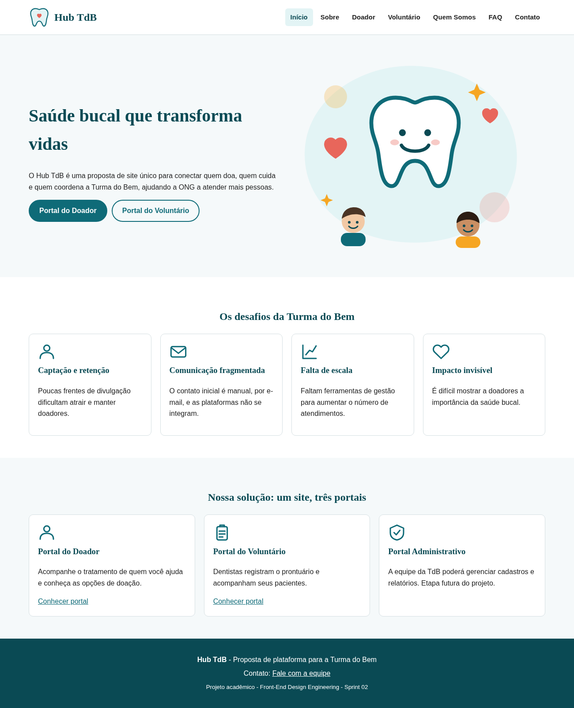

# Hub TdB - Front-end - Sprint 2

## Sobre o projeto
O Hub TdB é um projeto acadêmico para o Challenge da FIAP com a Turma do Bem. A ideia é reunir as informações de doadores, dentistas voluntários e da ONG em um só site. As páginas apresentam um protótipo de como seriam os portais.

## O que mudou da Sprint 1 para a Sprint 2
- Mantivemos as sete páginas da Sprint 1 e o visual azul-esverdeado do Hub TdB.
- Adaptamos o layout para desktop, tablet e celular usando `@media` no CSS.
- Fizemos um menu hambúrguer que abre e fecha no celular e tablet.
- Adicionamos validação do formulário de contato em JavaScript, com mensagens e bordas nos campos incorretos, sem usar `required`.
- No Portal do Doador, criamos um filtro de beneficiários e atualização do valor escolhido na simulação de doação.
- No Portal do Voluntário, acrescentamos verificação dos campos do prontuário de demonstração.

**Atenção:** O projeto é apenas um protótipo de front-end. Não existe login, banco de dados, prontuário real, envio de e-mails ou processamento de doações. Os nomes e registros das telas de exemplo são fictícios.

## Tecnologias
- HTML: páginas, links, tabelas, formulários e tags semânticas.
- CSS: cores, espaçamentos, Flexbox e media queries.
- JavaScript: variáveis, funções, condições, laços, eventos e alteração de elementos do HTML (DOM).
- Git/GitHub: versionamento do projeto pela equipe.

O projeto usa assuntos indicados nas aulas 0 a 12 do primeiro semestre da apostila de Front-end Design Engineering. O acesso integral aos exemplos das aulas estava bloqueado no momento da revisão, então essa comparação considera os títulos e tópicos identificados. As funções do JavaScript foram mantidas simples e sem bibliotecas externas.

## Estrutura das pastas
```
Hub_TdB/
  index.html
  sobre.html
  portal-doador.html
  portal-voluntario.html
  integrantes.html
  faq.html
  contato.html
  css/style.css
  js/script.js
  imagens/ (logo, ilustração, ícones e avatares de reserva)
  README.md
```

## Como abrir
No repositório, abra `index.html` no navegador. Também é possível usar o VS Code com a extensão Live Server. No celular, use a opção de visualização responsiva do navegador para testar o menu.

## Equipe - turma 1TDSPT
| Nome | RM | GitHub | LinkedIn |
|---|---|---|---|
| Erik Vasconcelos Da Silva | 575396 | https://github.com/Xcodebyerik | https://www.linkedin.com/in/erik-vasconcelos-9bb074365 |
| Felipe Augusto Araújo Ramos da Silva | 575627 | https://github.com/Felipeaards | https://www.linkedin.com/in/felipe-augusto-ara%C3%BAjo-ramos-da-silva-bb7223278 |
| Matheus Silva Matias de Medeiros | 574918 | https://github.com/matheusmmedeiros21-create | Não informado |
| Guilherme de Oliveira Andrade | 576432 | https://github.com/guilhermeoliveira33 | https://www.linkedin.com/in/guilherme-oliveira-57a52342b |
| Erick Medeiros Dantas | 576627 | https://github.com/erickdantaxs | Não informado |

Fotos e identificação dos integrantes aparecem em `integrantes.html`. As fotos da Sprint 1 são reutilizadas pelo caminho local `imagens/`, sem depender do carregamento pelo GitHub. Os avatares de reserva continuam disponíveis. Dois links genéricos de LinkedIn foram substituídos por “Não informado”; nenhum perfil foi inventado.

## Imagem da página inicial


## Repositório
O projeto está disponível em https://github.com/Felipeaards/Sprint1---Front-End.

## Contato
O formulário de `contato.html` demonstra validação, mas não envia mensagens. Para contato com os autores, consultar os links de perfil em `integrantes.html`.
