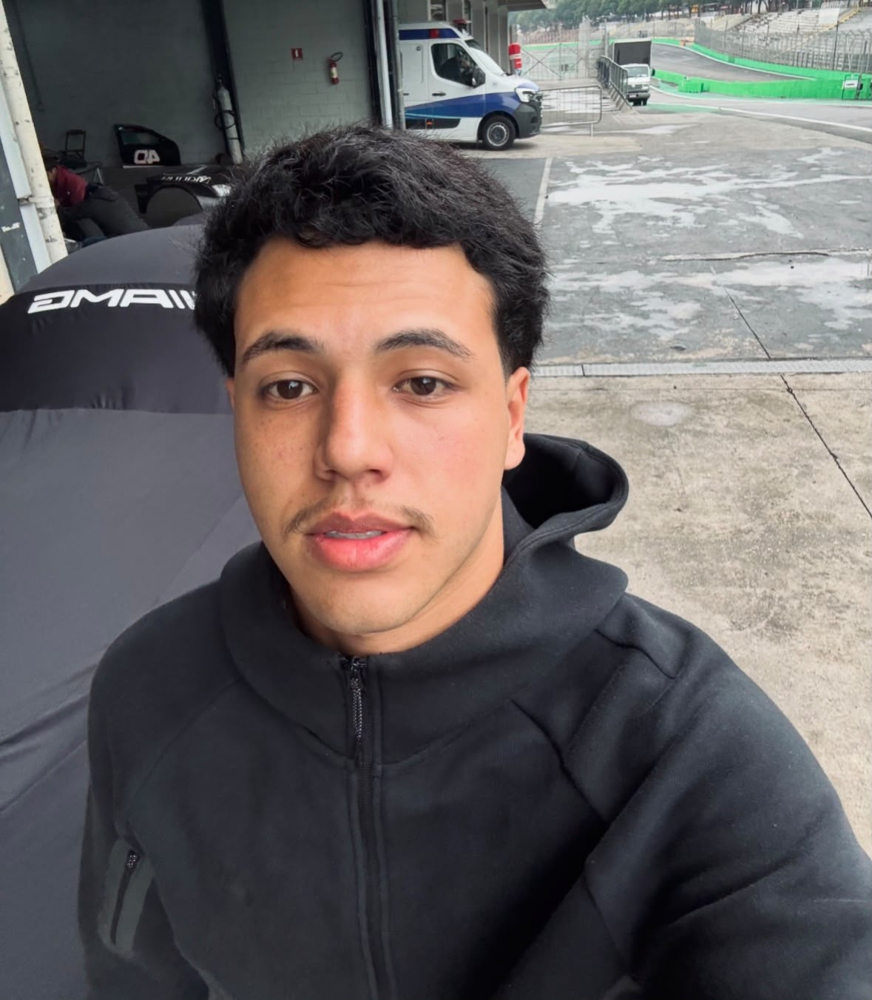
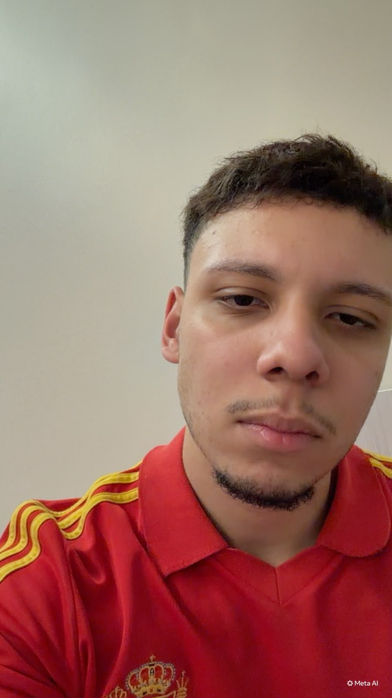
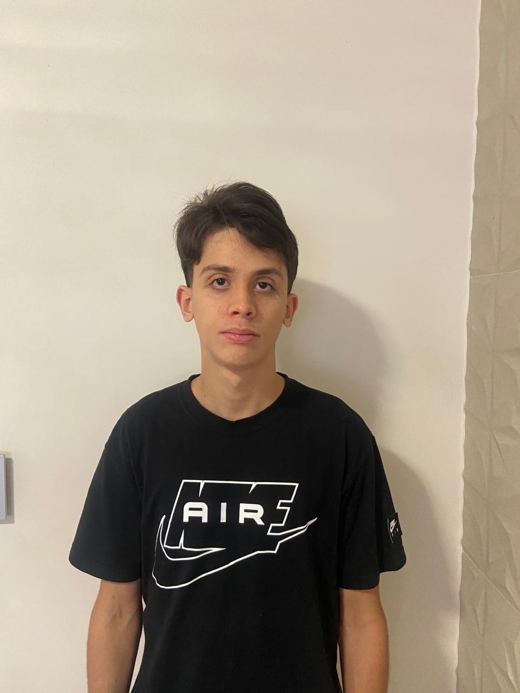
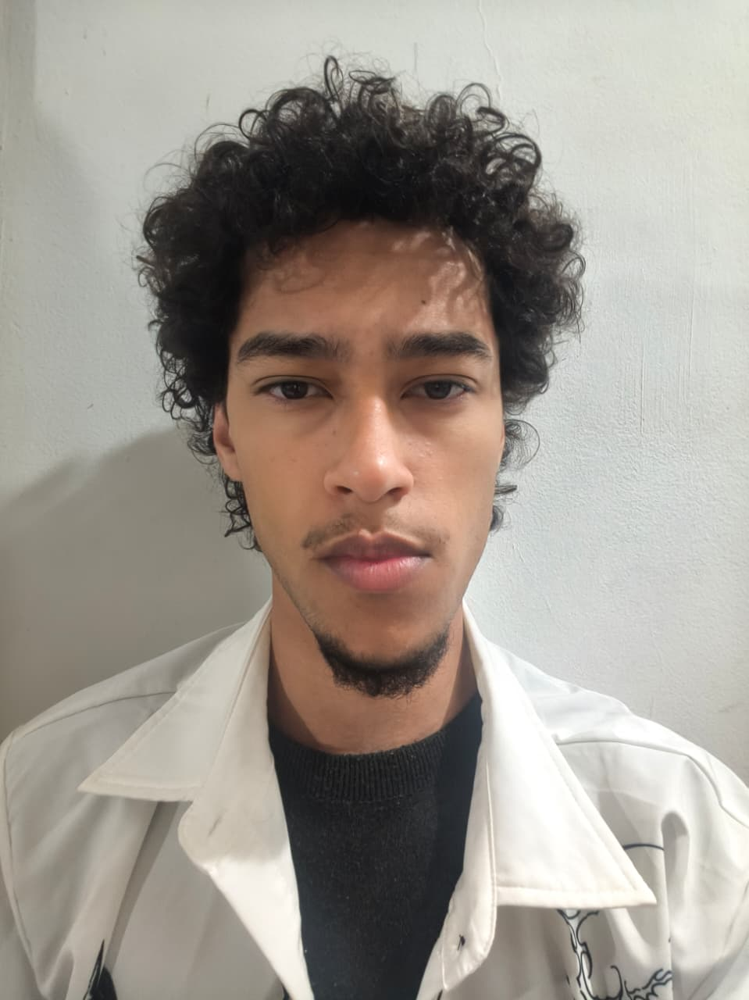

# Hub TdB - Plataforma Turma do Bem

Projeto da Sprint 01 de Front-End Design Engineering (versão desktop, apenas HTML e CSS).

## Descrição

O Hub TdB é a proposta de um site único para a **Turma do Bem (TdB)**, ONG que conecta pessoas
que precisam de cuidado odontológico a dentistas voluntários. O site reúne doadores, dentistas
e a equipe da ONG, resolvendo problemas como a captação de doadores, a comunicação manual por
e-mail e a dificuldade de mostrar o impacto das doações.

Nesta etapa existem protótipos estáticos de dois portais: **Doador** e **Voluntário**.

## Links

- Repositório no GitHub: `COLOCAR O LINK AQUI`
- Site publicado (GitHub Pages): `COLOCAR O LINK AQUI`

## Tecnologias utilizadas

- HTML5
- CSS3
- Git e GitHub

(Sem JavaScript, frameworks CSS ou bibliotecas externas.)

## Estrutura de pastas

```
tdb-simples/
├── index.html               Página inicial
├── sobre.html               Contexto, solução, tecnologias e roadmap
├── integrantes.html         Quem somos
├── faq.html                 Perguntas frequentes
├── contato.html             Formulário de contato
├── portal-doador.html       Página da solução 1
├── portal-voluntario.html   Página da solução 2
├── css/
│   └── style.css            Estilos do site
├── imagens/                 Logo, ilustração e ícones
└── README.md
```

## Autores

| Foto | Nome | RM | Turma | GitHub | LinkedIn |
|---|---|---|---|---|---|
|  | Felipe Augusto Araújo Ramos da Silva | 575627 | 1TDSPT | [GitHub](https://github.com/Felipeaards) | [LinkedIn](https://www.linkedin.com/in/felipe-augusto-araújo-ramos-da-silva-bb7223278?utm_source=share_via&utm_content=profile&utm_medium=member_android) |
|  | Erick Medeiros Dantas | 576627 | 1TDSPT | [GitHub](https://github.com/erickdantaxs) | [LinkedIn](https://www.linkedin.com/in/usuario-2) |
|  | Matheus Silva Matias de Medeiros | 574918  | 1TDSPT | [GitHub](https://github.com/matheusmmedeiros21-create) | [LinkedIn]() |
|  | Guilherme de Oliveira Andrade | 576432  | 1TDSPT | [GitHub](https://github.com/usuario-4) | [LinkedIn](https://www.linkedin.com/in/guilherme-oliveira-57a52342b) |
|  | Erik Vasconcelos Da Silva | 575396 | 1TDSPT | [GitHub](https://github.com/Xcodebyerik) | [LinkedIn](https://www.linkedin.com/in/erik-vasconcelos-9bb074365) |

## Imagens

- `imagens/logo.svg`: logo do projeto
- `imagens/hero-ilustracao.svg`: ilustração da página inicial
- `imagens/icone-*.svg`: ícones dos cards

(Adicionar aqui prints das páginas antes da entrega.)

## Contato

E-mail: `contato@hubtdb.exemplo.br` (trocar pelo e-mail da equipe)
